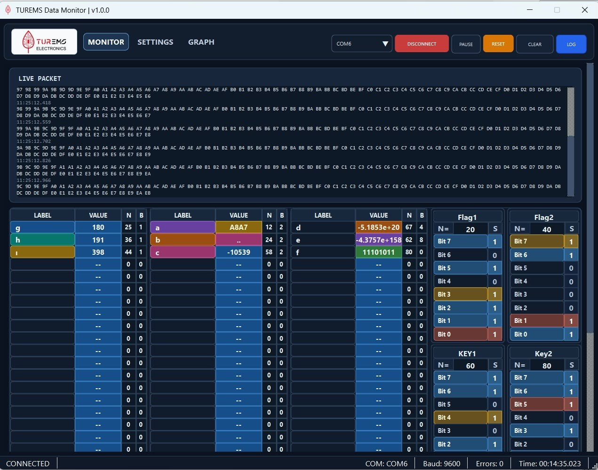
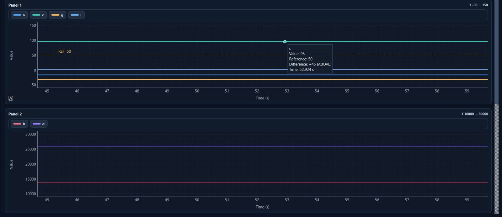

# UART Data Monitor

### Python ve PySide6 ile Gerçek Zamanlı Seri Veri İzleme Uygulaması

**UART Data Monitor**, UART/seri port üzerinden iletilen verileri masaüstünde izlemek, yorumlamak, görselleştirmek ve kaydetmek amacıyla bireysel olarak geliştirdiğim bir uygulamadır. Projede seri haberleşme yönetimi, paket bazlı veri gösterimi, canlı grafikler ve kullanıcıya özel yapılandırmalar tek bir arayüzde birleştirilmiştir.

> **Portfolyo / proje tanıtımı:** Bu depo uygulamanın teknik kapsamını tanıtmak için oluşturulmuştur. Kaynak kodları, şirkete ait görseller, kurulum paketleri ve gerçek cihaz verileri bu herkese açık depoda paylaşılmamaktadır.

## Projenin Amacı

Seri haberleşme üzerinden gelen verileri yalnızca ham metin olarak görüntülemek yerine, anlamlandırılabilen ve analiz edilebilen bir yapıda sunmak; izleme, grafikleme ve kayıt işlemlerini tek bir Windows masaüstü uygulamasında toplamak.

## Uygulama Ekran Görüntüleri

### 1. Canlı UART monitörü
Seri port üzerinden gelen verilerin paket bazında izlenmesi, sayısal alanların ve bit durumlarının görüntülenmesi.



### 2. Grafik ekranı
Gerçek zamanlı veri akışının grafikler üzerinden izlenmesi ve değişimlerin görselleştirilmesi.


### 3. Çoklu grafik paneli
Birden fazla veri alanının ayrı panellerde eş zamanlı olarak takip edilmesi.



## Temel Özellikler

- **UART bağlantı yönetimi:** Kullanılabilir COM portlarını listeleme; baud rate, parity, veri bitleri, stop bitleri ve akış kontrolü parametrelerini yapılandırma.
- **Canlı veri izleme:** Gelen seri paketlerin izlenmesi, sayısal alanların ve bit durumlarının gösterilmesi.
- **Gerçek zamanlı grafikler:** Gelen veri alanlarının zaman içinde değişimini grafik panelleri üzerinden takip etme.
- **Veri kaydı:** İzlenen verileri Excel ile açılabilen **CSV** biçiminde dışa aktarma.
- **Profil yönetimi:** İletişim ve görünüm ayarlarını kaydetme, daha sonra tekrar kullanma.
- **Arayüz özelleştirmesi:** Açık ve koyu tema seçenekleri.
- **Arayüz ve haberleşme ayrımı:** Seri veri alımını kullanıcı arayüzünden ayrı bir süreçte yönetmeye yönelik mimari.

## Kullanılan Teknolojiler

| Teknoloji | Kullanım amacı |
| --- | --- |
| Python | Uygulama mantığı ve veri işleme |
| PySide6 (Qt) | Masaüstü kullanıcı arayüzü |
| pySerial | UART / seri port haberleşmesi |
| PyQtGraph | Gerçek zamanlı grafikler |
| NumPy | Sayısal veri işleme |
| CSV | Veri dışa aktarma biçimi |
| PyInstaller | Windows çalıştırılabilir uygulama paketleme |

## Çalışma Akışı

```text
UART / USB-Seri Cihaz
        |
        v
Seri Port Bağlantısı
        |
        v
Veri / Paket Okuma
        |
        +----> Canlı Monitör
        |
        +----> Veri Yorumlama ve Grafikler
        |
        +----> CSV Kayıt
```

## Geliştirme Sürecindeki Çalışmalarım

Bu proje, staj sürecimde **bireysel olarak** geliştirdiğim bir masaüstü yazılım çalışmasıdır. Seri haberleşme akışını uygulama arayüzüyle bütünleştirdim; canlı izleme, grafikleme, profil yönetimi, tema desteği ve veri kayıt bileşenleri üzerinde çalıştım. Uygulamayı Windows ortamında paketlemeye yönelik geliştirmeler de gerçekleştirdim.

## Proje Durumu

Masaüstü uygulaması ve Windows'ta çalıştırılabilir paketleme çalışmaları tamamlanmıştır. Bu depo bir **tanıtım deposudur**; buradan uygulama indirme veya kaynak kod üzerinden çalıştırma seçeneği sunulmamaktadır.

## Paylaşım Notu

Uygulama, bir staj çalışması kapsamında geliştirilmiştir. Kuruma ait marka unsurları, özel cihaz bilgileri, gerçek veriler ve hak sahipliği açısından netleştirilmemiş materyaller bu depoya eklenmemiştir. Bu depo bir açık kaynak lisansı veya yazılım dağıtım izni anlamına gelmez.
